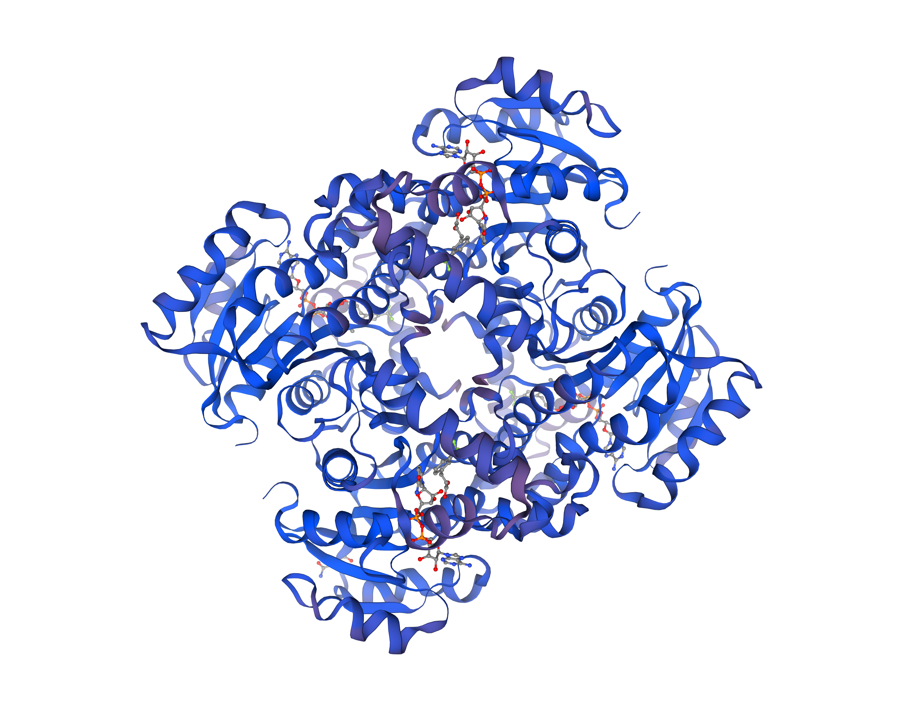
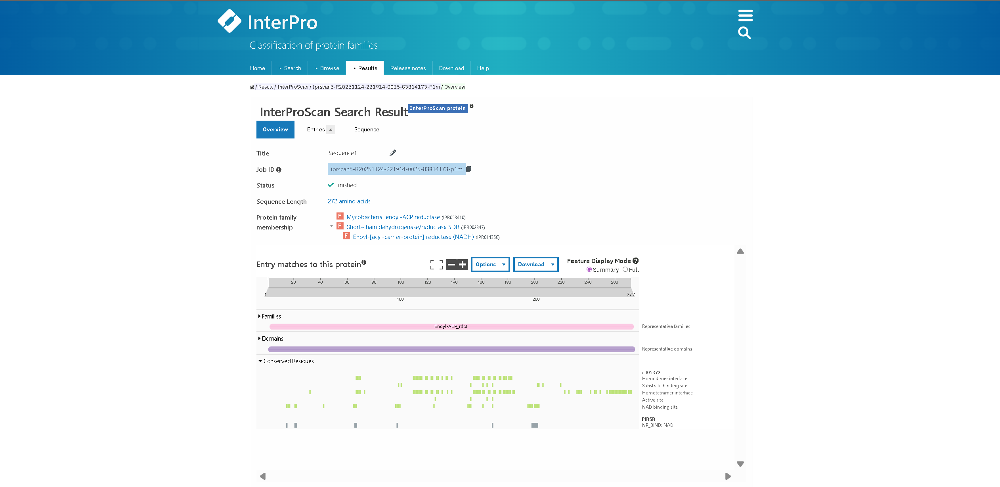
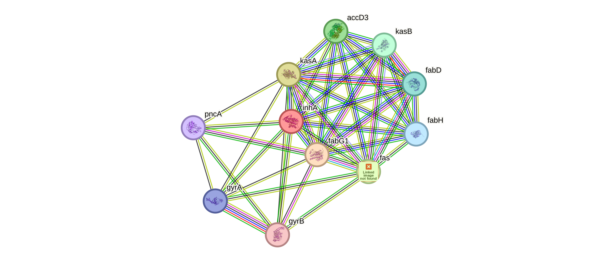
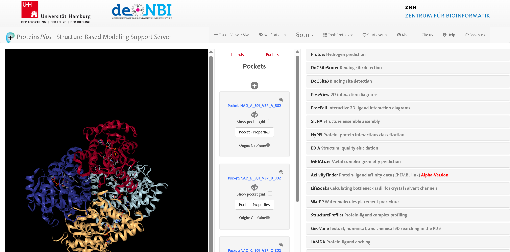
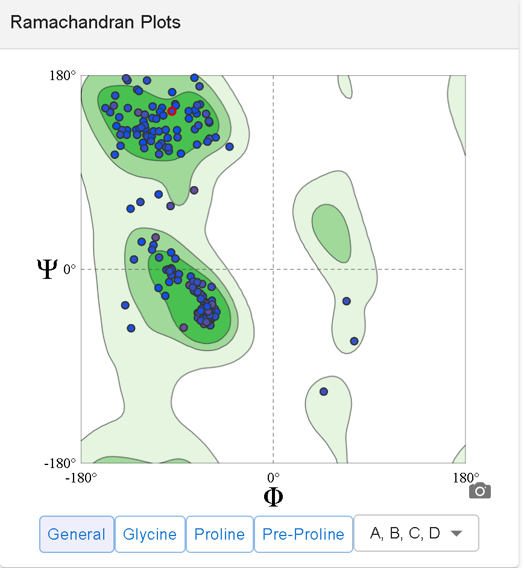
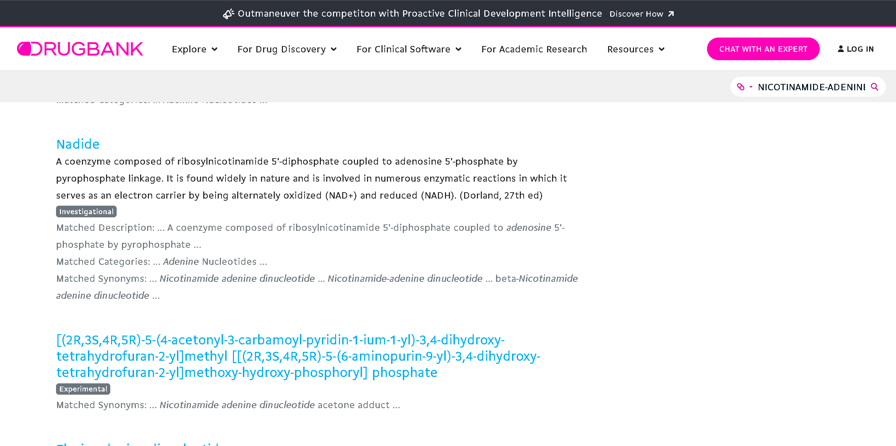
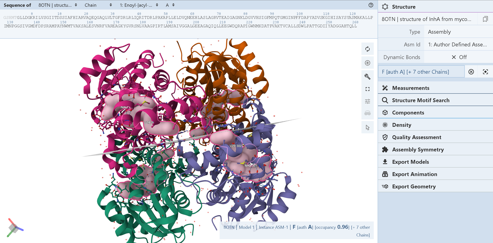

# Mtb-InhA-Drug-Design 

## 📋 Project Overview
This repository contains a computational biology and computer-aided drug design (CADD) study focusing on the **InhA enzyme** (Enoyl-[acyl-carrier-protein] reductase, Gene: `Rv1484`), a critical target for anti-tubercular therapeutics. The project explores the structural properties of the target protein, protein-protein interaction networks, active site pockets, and virtual screening of potential inhibitors.

* **Organism:** Mycobacterium tuberculosis (MT)
* **Protein:** InhA, also known as Enoyl-[acyl-carrier-protein] reductase
* **Gene:** Rv1484
* **Function:** InhA is an enzyme involved in fatty acid synthesis, specifically in the synthesis of mycolic acid which are long chain fatty acids unique to mycobacterial cell walls.

### **Vital Pathways:**
* InhA participates in the fatty acid elongation process of Type2 fatty acid synthase system (FAS-II).
* This system is critical for mycolic acids and essential components to the mycobacterial cell wall.
* Mycolic acids provides the cell wall with impermeability and resistance to host defence and antibiotics, crucial for MT’s virulence and survival.
* InhA catalyzes the NADH dependent reduction of enoyl-ACP, a critical step in fatty acid chain elongation.

### **Importance of InhA as a Drug Target:**
* InhA is the primary target of the frontline anti-TB drug isoniazid (INH) and second-line drug ethionamide.
* INH inhibits InhA by forming a complex after enzymatic activation, disrupting mycolic acid synthesis which compromises the bacterial cell wall, leading to bacterial death.
* Mutations in InhA or its promoter region are common mechanisms of INH resistance.
* Because humans do not synthesize mycolic acids and lack FAS-II, InhA is a selective and effective drug target.

### **Protein Data Bank (PDB) Information:**
* The crystal structure of InhA from M. tuberculosis has been solved by X-ray crystallography.
* **Example PDB IDs:** `1BVR`, `2NSD`, `4TRN`, `8OTN`
* Structures show InhA complexed with NADH, fatty acyl substrates, and various inhibitors, useful for drug design.

### **Properties and Key Features:**
* **Molecular Weight:** Approximately 29 kDa
* **Structure:** Homotetrameric enzyme with each subunit harboring a Rossmann fold binding NADH.
* **Active Site:** Hydrophobic pocket that binds enoyl-ACP substrates and inhibitors.
* Essential enzyme for mycolic acid biosynthesis, critical for cell wall integrity.

### **Methods to Identify and Study the Protein:**
* **Genetics**: Gene knockout and mutation studies confirm essentiality and resistance mechanisms.
* **Bioinformatics:** Annotated in Mycobrowser (Rv1484), STRING for interactions.
* **Structural Biology:** Numerous crystal structures for studying enzyme mechanism and inhibitor binding.
* **Drug screening:** Molecular docking and inhibitor design focused on the hydrophobic active site.

The protein structure selected for the study is `8OTN`.

---

## 📊 Key Results & Visualizations

### 1. Retrieving PDB Structure

* The RCSB Protein Data Bank (https://www.rcsb.org/) was used to search for and download the 3D structure file of the target protein by entering the PDB ID (e.g., 8OTN) in the search bar.
* The structure file in PDB format was saved for further analyses and visualization.

### 2. Identifying Enzyme Domains with Pfam/InterPro

* The UniProt website (https://www.uniprot.org/) was used to obtain the protein sequence or UniProt accession number.
* This sequence was entered into the InterPro (https://www.ebi.ac.uk/interpro/) or Pfam tool (https://www.ebi.ac.uk/interpro/search/sequence/) and the search was run.
* The output listed all matched protein domains, which were downloaded in formats such as TSV, JSON, XML, or as a screenshot of the webpage.

### 3. Determining Physicochemical Properties with ProtParam

* The protein’s amino acid sequence was pasted into the ExPASy ProtParam tool (https://web.expasy.org/protparam/).
* On submission, the results page provided properties such as molecular weight, theoretical pI, composition, and stability indices.

### 4. Analyzing Protein-Protein Interactions with STRING

* The STRING database (https://string-db.org/) was accessed and the protein name or UniProt accession was entered in the search bar.
* The organism (e.g., Mycobacterium tuberculosis) was specified to filter relevant interactions.
* STRING displayed an interactive network with predicted protein-protein interactions and functional partners.

### 5. Identifying Active Sites with CASTp or DoGSiteScorer

* The CASTp server (http://sts.bioe.uic.edu/castp/) was opened and the PDB ID (e.g., 8OTN) was submitted.
* The server analyzed the structure and returned predicted active site pockets and residue information.

### 6. Protein Structure Validation (Ramachandran Plot)

* The 3D structure file was obtained from Swiss-Model (https://swissmodel.expasy.org/interactive) or RAMPAGE (http://mordred.bioc.cam.ac.uk/~rapper/rampage.php) online servers.
* The Ramachandran plot was generated, displaying allowed/disallowed regions for protein backbone dihedral angles.

### 7. Drug-Ligand Information Search (FDA Status)

* DrugBank (https://go.drugbank.com/) was used to search for the ligand (e.g., NAD, NADH, or small-molecule inhibitors).
* The official DrugBank entry for the ligand was checked for FDA approval status, mechanism of action, and clinical relevance.

### 8. Virtual Screening

* Online virtual screening tools (such as SwissDock: http://www.swissdock.ch/ or CB-Dock: https://cb-dock.shao.ac.cn/) were used.
* The protein structure and ligand files (in mol2 or SMILES) were uploaded.
* The docking job was submitted, and the results (binding poses, scores) were retrieved after the computational run was completed.

